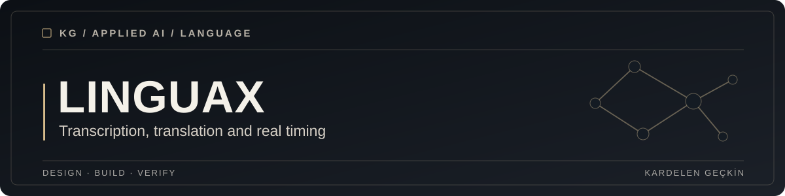

<div align="center">



**An educational AI application that turns video and audio clips into timed subtitles.**

[Getting started](#getting-started) · [Architecture](docs/ARCHITECTURE.md) · [Tests](#validation)

</div>

## Overview

LinguaX combines audio extraction, speech recognition and language translation in a Streamlit application. It uses Whisper's actual segment timestamps to generate SubRip subtitle files without guessing timing from text.

## What it includes

* Audio extraction from supported media using FFmpeg.
* Whisper transcription with real source audio timing.
* Optional translation into selected languages while retaining source cue boundaries.
* Individual subtitle downloads and a ZIP bundle for multiple clips.

## Getting started

**Requirements:** Python 3.11 or newer, an FFmpeg executable on your PATH and an OpenAI API key with available quota.

From the repository root:

```bash
cd Capstone
python -m venv .venv
```

Activate the environment using `source .venv/bin/activate` on macOS or Linux, or `.venv\Scripts\Activate.ps1` in Windows PowerShell.

```bash
python -m pip install -r requirements.txt
```

Copy `.env.example` to `.env` and set `OPENAI_API_KEY`. Check that `ffmpeg -version` works before launching.

```bash
streamlit run src/app.py
```

Upload a short media clip and optionally select translation languages. Audio and text are sent to the external AI provider. API use may incur charges.

## Repository structure

```text
Capstone/
├── assets/               # Project graphics
├── Data/                 # Original coursework demonstration media
├── docs/                 # Architecture and engineering decisions
├── src/                  # Streamlit UI, provider integration, subtitle logic
├── tests/                # Unit tests using mocked API responses
├── .env.example          # Local environment sample
├── requirements.txt
├── requirements-dev.txt
└── README.md
```

## Validation

```bash
python -m pip install -r requirements-dev.txt
python -m pytest -q tests
```

Tests validate timestamps, subtitle formatting and mocked provider responses. They do not require an API key or make paid calls. Full processing with FFmpeg and a live provider still needs a separate integration test.

## Architecture & decisions

The UI, external integrations and pure subtitle serialization live in separate modules. [Architecture notes](docs/ARCHITECTURE.md) describe the flow, tradeoffs and future improvements.

## Security & limitations

* Only upload media you are authorized to send to an external provider.
* Uploaded files are handled in a temporary directory and removed after processing.
* Results remain in the current Streamlit session.
* Input recordings above the extracted audio size limit require manual splitting.
* Translation retains source timing, which is not the same as target language subtitle alignment.
* This is an educational prototype, not a verified production deployment.

## License

The parent repository includes an [MIT license](../LICENSE). The original educational [presentation](https://www.canva.com/design/DAGQZMDAeEI/mwx65uoRkltHCMQhDoTUWg/view) is also available.
