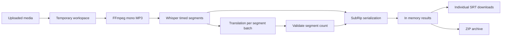

# LinguaX architecture

## Overview

LinguaX is a small, synchronous, local Streamlit application for educational use.

## Responsibilities

| File | Responsibility |
| --- | --- |
| src/app.py | Streamlit UI, upload lifecycle, session state, downloads |
| src/utils.py | External API and FFmpeg integration, response validation |
| src/subtitles.py | Timed cue domain model and deterministic SRT generation |
| tests | API mocks and edge case tests for SRT and translated segments |

## Technical decisions

**Timestamps:** Use the segment timestamps provided by Whisper with its
verbose_json response. No timestamps are inferred from text lines.

**Translation:** The app translates batches of up to 20 cues and validates
that the returned JSON contains exactly one nonempty string per input cue.
Translated cues inherit their source times. This is a useful starting point
but not a substitute for target-language subtitle alignment.

**Temporary files:** The user supplied filename is not used as a local path.
The app writes a fixed input name inside a per-request temporary directory,
extracts audio there, and deletes the directory after the operation.

**Secrets:** The OpenAI API key comes from an environment variable or an
ignored .env file. It is never embedded in source code.

**Data retention:** Results live in Streamlit session state. The app does not
save transcripts into SQLite. Temporary uploads are deleted after processing,
but external providers may retain data under their own service policies.

**Failure handling:** Missing timestamps, malformed translations, oversized
audio, conversion errors and invalid credentials do not silently create
incorrect subtitle files.

## Tradeoffs

- Large files require manual splitting when the extracted audio exceeds
  the configured size cap.
- Synchronization is inherited from the original audio. Translation length
  may require a future alignment or segmentation phase.
- The app uses a synchronous single-user workflow rather than a background
  queue, which is appropriate to the scope of an educational prototype.
- Provider calls are not part of the unit test suite.

## Suggested future work

1. Background processing with status persistence and retry handling.
2. Subtitle alignment and review before export.
3. Accessible video preview synchronized with subtitle cues.
4. Video duration and token cost estimation before processing.
5. Optional local-only history with explicit user consent.

## Security and data handling

Upload only data you are authorized to send to the API provider. Never place
API keys, client media, user transcripts, or private infrastructure data in
the Git repository.
