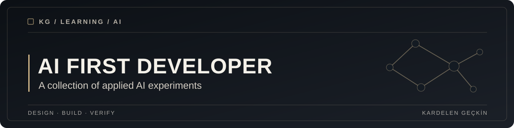

<div align="center">



**A collection of practical AI experiments, development exercises and a video transcription capstone.**

[Capstone](Capstone/) · [Explore the projects](#explore-the-materials) · [License](LICENSE)

</div>

## Overview

This repository documents work completed during the Up School AI First Developer education program. It contains small software exercises alongside the more substantial LinguaX capstone.

The directories represent different coursework activities and are not all independent production applications.

## Explore the materials

| Project | Contents |
| --- | --- |
| [LinguaX](Capstone/) | Video transcription, optional translation and timed subtitles |
| [Cat Facts](catfactsApplication/) | AI integration coursework and a small application |
| [CustomGPT](CustomGPT/) | Custom GPT development exercises |
| [Moviest](Moviest/) | Movie related application experiments |

## Getting started

Each exercise has different requirements. For LinguaX, see the [complete setup guide](Capstone/README.md) before running any commands.

```bash
cd Capstone
python -m pip install -r requirements.txt
streamlit run src/app.py
```

This requires Python, FFmpeg and your own API key. See the capstone README for environment setup, privacy considerations and associated costs.

## Repository structure

```text
UP-School-AI-First-Developer/
├── Capstone/               # LinguaX application and tests
├── catfactsApplication/    # Coursework
├── CustomGPT/              # Coursework
├── Moviest/                # Coursework
├── docs/assets/            # Repository cover
└── README.md
```

## Validation

LinguaX has an isolated test suite. Run `python -m pytest -q tests` from the `Capstone` directory after installing its development dependencies. Other coursework directories may not have automated test coverage.

## Architecture & decisions

Technical design and limitations for the featured capstone are documented in [LinguaX architecture](Capstone/docs/ARCHITECTURE.md).

## Security & limitations

Examples are educational. Do not upload confidential media, include API credentials in source control, or treat an exercise as production ready without separate review.

## License

See the [MIT license](LICENSE). External course content and third party media may have separate ownership terms.
